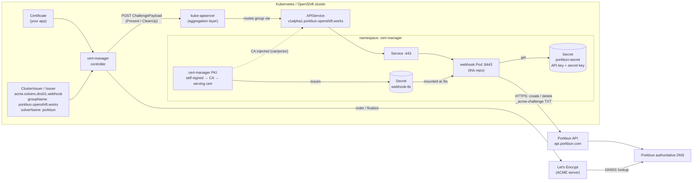
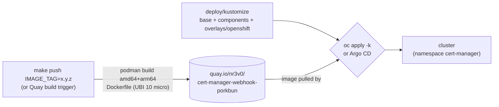

<p align="center">
  
</p>

# Porkbun Webhook for cert-manager

> **This is a clone of [Talinx/cert-manager-webhook-porkbun](https://github.com/Talinx/cert-manager-webhook-porkbun)**
> by Christoph Raitzig ([@Talinx](https://github.com/Talinx)). That project builds on
> [Brandon Sprague's original Porkbun webhook](https://github.com/bcspragu/cert-manager-webhook-porkbun),
> which was created from [cert-manager/webhook-example](https://github.com/cert-manager/webhook-example).
> The upstream commit history is preserved here. See [NOTICE](NOTICE) and [Credits](#credits).
>
> Differences from upstream: deployed with **Kustomize** instead of Helm, runs on a
> **UBI 10 micro** image published to **quay.io/nr3v0**, uses the API group
> `porkbun.openshift.works`, and has hardened RBAC, pod security and API-client error handling.

An implementation of the cert-manager
[`webhook.Solver` interface](https://pkg.go.dev/github.com/cert-manager/cert-manager/pkg/acme/webhook#Solver)
for [Porkbun](https://porkbun.com/) DNS. It lets cert-manager solve ACME **DNS01**
challenges (needed, for example, for wildcard certificates) for domains hosted at Porkbun.

## Repository layout

| Path | What it is |
| --- | --- |
| [`main.go`](main.go) | The solver: `Present` creates the `_acme-challenge` TXT record, `CleanUp` deletes it, and `Initialize` builds the Kubernetes client that reads the API-key Secret. `cmd.RunWebhookServer` serves it as a Kubernetes aggregated API. |
| [`porkbun/`](porkbun/) | Small Porkbun DNS API v3 client (retrieve, create and delete records; ping). It has timeouts, escaped URL paths, HTTP status checks and typed `StatusError`s. |
| [`deploy/kustomize/base/`](deploy/kustomize/base/) | Plain Kubernetes manifests: ServiceAccount, RBAC, cert-manager PKI (self-signed CA and serving cert), Service, Deployment, APIService, and the `groupName` ConfigMap. |
| [`deploy/kustomize/components/group-name/`](deploy/kustomize/components/group-name/) | A Kustomize component that copies `groupName` from the ConfigMap into the Deployment, APIService and RBAC. |
| [`deploy/kustomize/overlays/openshift/`](deploy/kustomize/overlays/openshift/) | The overlay you deploy. It pins the image tag and is where you override `groupName`. |
| [`Dockerfile`](Dockerfile) | All-UBI 10 multi-stage build: `ubi10/go-toolset:1.27` builder → static binary on `ubi10/ubi-micro`, plus the CA bundle from `ubi10/ubi-minimal`. Runs as non-root. |
| [`Makefile`](Makefile) | `test`, `test-conformance`, `build`, `push`, `rendered-manifest.yaml`, `deploy`. |
| [`testdata/porkbun/`](testdata/porkbun/) | Sample solver config and Secret for the conformance suite. |
| [`main_test.go`](main_test.go), [`solver_test.go`](solver_test.go), [`porkbun/porkbun_test.go`](porkbun/porkbun_test.go) | The conformance suite (build tag `conformance`) and offline unit tests. |
| [`example/`](example/) | The in-memory DNS solver example from the upstream cert-manager template, kept for reference (its startup race is fixed). It is not part of the webhook binary. |

## How it fits together

### At runtime



1. You create a `Certificate` that references an ACME `Issuer`/`ClusterIssuer` configured with the Porkbun webhook solver.
2. cert-manager places an ACME order and gets a DNS01 challenge. It sends a `ChallengePayload` to the API group `porkbun.openshift.works` through the kube-apiserver.
3. The `APIService` routes that group to this webhook's Service. The webhook's TLS certificate comes from the small cert-manager PKI in `pki.yaml`, and cainjector injects its CA into the APIService.
4. The webhook reads the Porkbun API keys from the Secret named in the solver config. It then creates the `_acme-challenge` TXT record through the Porkbun API (`Present`).
5. Let's Encrypt validates the record, cert-manager finalises the order, and the webhook deletes the record (`CleanUp`).

### Build and deploy



## Installation

### Prerequisites

- cert-manager installed in the `cert-manager` namespace ([docs](https://cert-manager.io/docs/installation/); on OpenShift, the *cert-manager Operator for Red Hat OpenShift* works too).
  If cert-manager's ServiceAccount or namespace differs, patch `cert-manager-webhook-porkbun:domain-solver` in an overlay.
- A [Porkbun API key pair](https://kb.porkbun.com/article/190-getting-started-with-the-porkbun-api), with **API Access enabled on each domain** in the Porkbun dashboard.

### Deploy the webhook

```bash
oc apply -k deploy/kustomize/overlays/openshift      # or: kubectl apply -k ...
# or render first:  make rendered-manifest.yaml  →  _out/rendered-manifest.yaml
```

With Argo CD, point an `Application` at this repo with `path: deploy/kustomize/overlays/openshift`.

> Do **not** set a top-level `namespace:` in an overlay. It would move the
> `kube-system` RoleBinding the webhook needs for authentication. Create your own
> overlay (copy `overlays/openshift`) to change the image tag or `groupName`.

### Create the credentials Secret

```yaml
apiVersion: v1
kind: Secret
metadata:
  name: porkbun-secret
  namespace: cert-manager   # the namespace of the Issuer, or cert-manager for a ClusterIssuer
type: Opaque
stringData:
  PORKBUN_API_KEY: pk1_yourapikeyhere
  PORKBUN_SECRET_API_KEY: sk1_yoursecretkeyhere
```

### Create an issuer

`groupName` must match the value in `deploy/kustomize/base/kustomization.yaml` (default `porkbun.openshift.works`):

```yaml
apiVersion: cert-manager.io/v1
kind: ClusterIssuer
metadata:
  name: letsencrypt-porkbun
spec:
  acme:
    email: you@example.com
    server: https://acme-v02.api.letsencrypt.org/directory
    privateKeySecretRef:
      name: letsencrypt-porkbun-account
    solvers:
      - dns01:
          webhook:
            groupName: porkbun.openshift.works
            solverName: porkbun
            config:
              apiKey:
                name: porkbun-secret
                key: PORKBUN_API_KEY
              secretApiKey:
                name: porkbun-secret
                key: PORKBUN_SECRET_API_KEY
```

### Request a certificate

```yaml
apiVersion: cert-manager.io/v1
kind: Certificate
metadata:
  name: example-cert
spec:
  secretName: example-cert
  issuerRef:
    name: letsencrypt-porkbun
    kind: ClusterIssuer
  dnsNames:
    - "example.com"
    - "*.example.com"
```

## Building the image

```bash
make build                       # podman (or docker) build -t quay.io/nr3v0/cert-manager-webhook-porkbun:latest .
make build IMAGE_TAG=1.1.0
```

Publish a multi-arch (amd64 + arm64) release from your workstation with podman:

```bash
podman login quay.io
make push IMAGE_TAG=1.1.0        # builds a manifest list and pushes it to quay.io/nr3v0/cert-manager-webhook-porkbun:1.1.0
```

Cross-building arm64 on an amd64 host needs `qemu-user-static` installed.

*Alternative:* set up a [Quay build trigger](https://docs.quay.io/guides/building.html) on this
GitHub repository. Quay adds a webhook and deploy key, then builds the `Dockerfile` on every push or tag.
Quay builders produce a single architecture.

## Running the tests

```bash
make test                        # offline unit tests (Porkbun client, solver, example), no credentials needed
```

All DNS01 webhooks **must** pass cert-manager's conformance suite. It runs against the real
Porkbun API and needs a zone you control:

```bash
cp testdata/porkbun/config.json.sample testdata/porkbun/config.json
cp testdata/porkbun/porkbun-credentials.yaml.sample testdata/porkbun/porkbun-credentials.yaml
# edit porkbun-credentials.yaml with your base64-encoded keys (both files are git-ignored)
TEST_ZONE_NAME=example.com. make test-conformance
```

## Credits

- **[Talinx/cert-manager-webhook-porkbun](https://github.com/Talinx/cert-manager-webhook-porkbun)**, by Christoph Raitzig, is the project this repository clones. It contributed the Helm chart (converted to Kustomize here), release automation and dependency updates.
- **[bcspragu/cert-manager-webhook-porkbun](https://github.com/bcspragu/cert-manager-webhook-porkbun)**, by Brandon Sprague, wrote the original Porkbun client and solver.
- **[cert-manager/webhook-example](https://github.com/cert-manager/webhook-example)**, by the cert-manager Authors, is the template and test harness.
- **[baarde/cert-manager-webhook-ovh](https://github.com/baarde/cert-manager-webhook-ovh)** was an inspiration for the original.

Licensed under the [Apache License 2.0](LICENSE).
